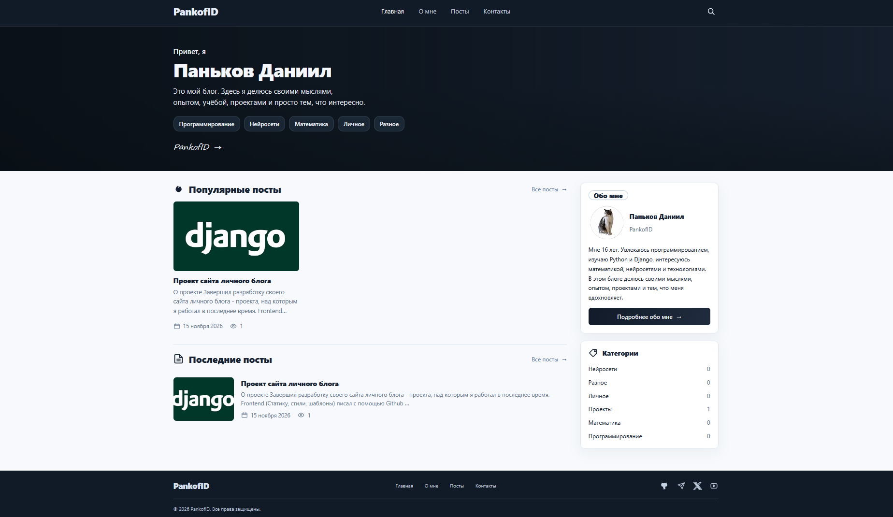

# Personal Blog on Django

Личный сайт-блог на фреймворке **Django**

---



Планируемое (to be):
* Возможность создавать посты с несколькими категориями
* Светлая и темная тема

---

## Установка и запуск

### Шаг 1. Клонирование репозитория

```bash
git clone https://github.com/PankofID/django_blog.git
cd django_blog
```

---

### Шаг 2. Настройка `.env`

В терминале выполните:

```bash
cp .env.example .env
```
После в файле .env замените значения переменных на свои.

---

### Запуск через виртуальное окружение (venv)

**1. Создание окружения**
```bash
python -m venv venv
```

**2. Запуск окружения**
Windows:
```bash
venv\Scripts\activate
```
Linux/MacOS:
```bash
source venv/bin/activate
```

**3. Установка зависимостей**

```bash
pip install -r requirements.txt
```

**4. Применение миграций**

```bash
python manage.py migrate
```

**5. Запуск сервера**

```bash
python manage.py runserver
```

Появится локальная ссылка:

```text
Starting development server at http://127.0.0.1:8000/
```

Если ошибок нет - откройте ссылку.

---

### Запуск через Docker контейнер

**Создание и запуск контейнеров**

```bash
docker compose up -d --build
```

Если ошибок нет - откройте локальную ссылку.<br>
Обычно - http://127.0.0.1:8000/
